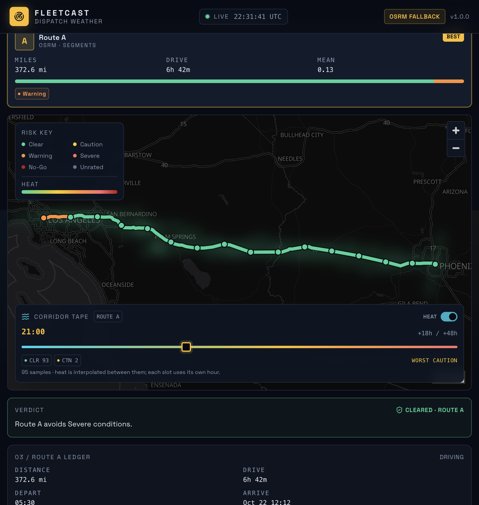

# FleetCast — Dispatch Weather Console

A weather-aware routing board for truck dispatchers. Enter a lane, departure time, and load; FleetCast scores up to three alternatives against the forecast each truck will actually meet, then clears or holds the board.



## What it does

- Geocodes the lane, fetches distinct route alternatives (ORS `driving-hgv` when a key is configured, OSRM otherwise), and de-duplicates near-identical geometry.
- Places checkpoints at exact mile intervals (10/25/50 mi) and computes ETAs from the router's own segment timing.
- Reads Open-Meteo hourly forecasts at each stop's ETA — rain and snowfall kept separate, units normalised to mph / in-hr / °F.
- Applies the corridor risk model (Clear / Caution / Warning / Severe / No-Go) with load-dependent wind rules.
- Aggregates distance-weighted exposure per route and ranks by Severe miles → Warning miles → mean risk → travel time.
- Holds the board when any route carries No-Go miles, and shows a clearly labelled least-exposure reference instead.
- Renders risk-coloured route segments, stop popups, and a 0–48 hour corridor heat tape on a dark map.

## Stack

| Layer | Choice |
|---|---|
| API | Python 3.12+, FastAPI, Uvicorn, HTTPX, Pydantic |
| Web | React 19, TypeScript, Vite, Tailwind CSS 4, MapLibre GL, SWR |
| Providers | OpenRouteService (optional), OSRM fallback, Open-Meteo, Nominatim, OpenFreeMap Dark |
| Tests | pytest + respx + ASGI transport · Vitest + Testing Library |

## Layout

```
backend/app/
  domain/        risk bands, geo interpolation, checkpoints, exposure ledger, verdict
  providers/     geocode, routing (ORS/OSRM), weather (Open-Meteo)
  services/      trip analysis and corridor tape
  main.py        FastAPI routes + error envelope
frontend/src/
  features/      PlanForm, RouteRail, Inspector, MapStage, Timeline
  components/    header, ledger bar, level chips, legend
  lib/           risk metadata, formatting, form validation
```

## Run locally

Prerequisites: Python 3.12+ and Node 20+.

```bash
# terminal 1
cd backend
python3 -m venv .venv
source .venv/bin/activate
pip install -r requirements-dev.txt
uvicorn app.main:app --reload --port 8100

# terminal 2
cd frontend
npm install
npm run dev
```

Open **http://localhost:5174**. Vite proxies `/api` to `:8100`, so no CORS setup is needed in development.

Optional — truck profile and alternatives:

```bash
echo "FC_ORS_API_KEY=your_key" >> backend/.env
```

Free key: <https://openrouteservice.org/dev/#/signup>. Without it, the console uses OSRM (car profile) and the header shows **OSRM FALLBACK**.

## API

`POST /api/trips/analyze`

```json
{
  "origin": "Los Angeles, CA",
  "destination": "Phoenix, AZ",
  "depart_at": "2026-10-22T14:00:00-07:00",
  "load_lbs": 35000,
  "interval_mi": 25
}
```

Response shape: `trip`, `routes[]` (with `stops`, `segments`, `ledger`), `verdict`, `alerts`.

`POST /api/trips/corridor` — body `{ "path": [[lon,lat], …], "load_lbs": 35000, "route": "A" }` returns 49 hourly slots and corridor samples. The endpoint is stateless, so it works on serverless hosts.
`GET /api/places?q=…` — autocomplete. `GET /api/health` — provider status.

Errors are `{"error": {"code", "message", "field"}}` with 4xx/5xx status codes.

## Risk model

| Level | Wind (mph) | Rain (in/hr) | Snow (in/hr) |
|---|---|---|---|
| Clear | < 25 | < 0.10 | < 0.50 |
| Caution | 25–34 | 0.10–0.24 | 0.50–0.99 |
| Warning | 35–44 | 0.25–0.49 | 1.00–1.99 |
| Severe | 45–54 | 0.50–1.00 | 2.00–3.00 |
| No-Go | ≥ 55 | > 1.00 | > 3.00 |

Bands are lower-inclusive: a value on a shared boundary takes the more severe band. Load overrides: wind ≥ 55 closes the lane for any load; 45–54 mph with > 30,000 lb is No-Go; 35–44 mph with > 40,000 lb is at least Severe.

Exposure is attributed per checkpoint interval to the worse endpoint, so miles always sum to the route distance. Unrated segments are excluded from averages and never treated as Clear. Any No-Go miles remove a route from the cleared ranking.

## Tests

```bash
cd backend && pytest -q        # 94 passed
cd frontend && npm test        # 29 passed
npm run lint && npx tsc --noEmit && npm run build
```

Backend tests cover every risk boundary, all load rules, geospatial interpolation, ETA math, unit conversion, forecast matching, exposure conservation, ranking order, provider failures, and the API/corridor contract using static fixtures.

## Docker

```bash
docker compose up --build
```

- Web: <http://localhost:8081>
- API: <http://localhost:8100>

## Deploy

Both services run on Vercel:

**API** — project root `backend`. Vercel detects the FastAPI `app` in `app/main.py` and runs it as one Fluid function (`maxDuration: 60` in `backend/vercel.json`). Set:
- `FC_CORS_ORIGINS` (web origin, or `*` for a demo)
- `FC_ORS_API_KEY` (optional)

**Web** — project root `frontend`, framework Vite. Set `VITE_API_BASE_URL` to the API URL before building.

```bash
# API
cd backend
vercel deploy --prod --project fleetcast-api --create-if-missing \
  --env 'FC_CORS_ORIGINS=https://your-web.vercel.app'

# Web
cd frontend
vercel deploy --prod --project fleetcast --create-if-missing \
  --build-env VITE_API_BASE_URL=https://your-api.vercel.app
```

The analysis and corridor endpoints are stateless, so they survive serverless cold starts. Render remains an option via `render.yaml` for a long-running container, but the current deployment uses Vercel for both.

Live demo: **https://fleetcast-beta.vercel.app** · API: **https://fleetcast-api.vercel.app**

## Notes and limits

- OSRM's public server and Nominatim are best-effort, rate-limited services. Routes are truck-aware only with an ORS `driving-hgv` key; bridge, axle, and road-weight limits still need dispatcher verification.
- Forecasts beyond 16 days are unusable; the tape covers the next 48 hours and is a spatial interpolation between corridor samples, not point observations.
- Analysis state is held in-process with TTLs; a multi-worker deployment should swap `app/cache.py` for Redis.
- No accounts or saved trips — the board is a stateless analysis tool.

## Attribution

Weather: Open-Meteo · Routing: OpenRouteService / OSRM · Geocoding: OpenStreetMap Nominatim · Tiles: OpenFreeMap © OpenMapTiles, data © OpenStreetMap contributors.
